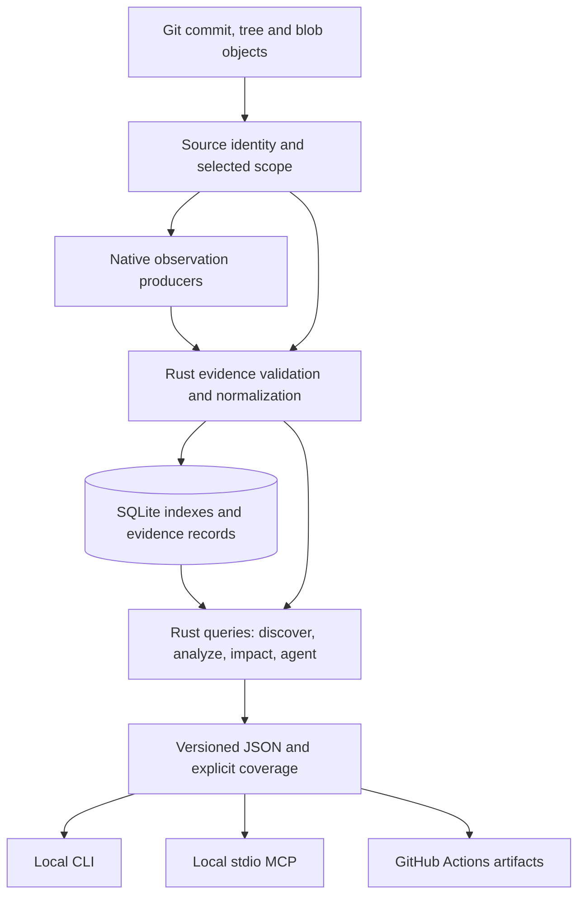

# Architecture

Excession is a Git-grounded source-analysis engine. Its primary runtime is
a Rust CLI. SQLite stores derived indexes and observations; native language
tools provide their own evidence. Git source bytes and external evidence
remain distinguishable from Excession's inferences.

This page describes the **current architecture**, not a proposed service
deployment or a promise of cross-language semantic completeness.

## Data flow



The arrow from an observation producer to the evidence layer means
**reported input**, not “proved dependency”. The exported JSON retains
the original producer and source context. The database is rebuildable,
not an alternative source-control history.

## Ownership and authority

| Part | Authority | Implementation |
| --- | --- | --- |
| Source revision and file identity | Git commit, tree, path, mode and blob | [Git source access](../core/src/source/git.rs), [source identity](../core/src/source/identity.rs) |
| Source scope and available capabilities | Explicit roots, tracked files, installed native tools | [Discovery](../core/src/discovery.rs), [source capabilities](../core/src/source_capabilities.rs) |
| Static candidate relations | Named language-specific producers and their original observations | [Adapter boundary](../core/src/adapter.rs), [analysis](../core/src/analyze.rs) |
| Symbol and configured-build evidence | Native SCIP, compiler, and configured input records | [SCIP evidence](../core/src/scip_evidence.rs), [observed relations](../core/src/observed_relations.rs) |
| Derived storage and queries | Rust validation over SQLite records | [Indexing](../core/src/index.rs), [evidence store](../core/src/evidence_store.rs) |
| Agent-facing queries | Bounded source/evidence views and explicit obligations | [Agent context and verify](../core/src/agent.rs), [locate](../core/src/agent_locate.rs) |
| CLI and local agent protocol | Same Rust computations, different transport | [CLI](../core/src/bin/excession.rs), [stdio MCP](../core/src/bin/excession/mcp.rs) |

The compiler, parser, and scanner are still responsible for the
semantics of their own observations. Excession should consume those
results consistently, not reimplement every language's resolver.

## Three supported interfaces

### 1. Native CLI

`excession` runs within a local repository and emits operation-specific
results. It supports source discovery and analysis, impact witnesses,
evidence queries, and more specialized native-producer commands.
Certain commands require trusted local tools or a clean checkout;
`doctor` and the command-specific contracts make those prerequisites
explicit.

Entry points: [quick start](QUICKSTART.md), [CLI reference](CLI.md),
[agent-facing commands](AGENT_CLI.md).

### 2. GitHub-native execution

An authorized GitHub issue or manual dispatch names an allowlisted public
repository, exact commit, and supported operation. A standard GitHub Actions
runner builds the real Excession Rust CLI with locked dependencies,
fetches the requested Git objects, executes the operation, checks native
schema and commit/tree identities, then uploads its original JSON report,
receipt and summary. No GCP or persistent HTTP service is needed.

A **separate reusable GitHub workflow** performs base/head PR evidence
generation. It retains the native verification and context outputs,
source witnesses, coverage and unresolved obligations. Neither route
performs unspecified behavioral tests.

Entry points: [on-demand requests](GITHUB_NATIVE_ANALYSIS.md),
[PR evidence](GITHUB_EVIDENCE.md), [CI policy](CI.md).

### 3. Local stdio MCP

A compatible coding agent can launch the Rust executable as a
repository-scoped stdio MCP server. The local MCP adapter calls
the same analysis functions as the CLI. It does not establish
a remote ChatGPT connector or a second analysis engine.

Entry point: [local MCP](MCP.md).

## Identities and provenance

The identity chain is:

```text
repository + commit + tree
  -> path + entry mode + blob
  -> producer and configuration
  -> original observation and receipt
  -> derived relationship / bounded query
  -> report schema, coverage and unresolved obligations
```

A source reference identifies *where an observation comes from*.
It does not prove a call executes, a test is complete, or a scanner
finding is exploitable. A deterministic replay checks only the
properties it actually compares. [Evidence and limits](EVIDENCE_AND_LIMITS.md)
describes the separate proof obligations.

## SQLite and cache lifecycle

SQLite holds indexed relations and evidence records. The agent locator
also uses a segmented FTS5 cache keyed to authenticated Git source.
The cache is updated incrementally, and a partial refresh is reported as
partial coverage. No result is promoted to complete because a cache
exists or because a workflow finished.

In GitHub Actions, Git clones, SQLite files and intermediate compiler
outputs are disposable. The durable *within-retention* output is the
versioned artifact with its receipt. Reproduction requires the source
and tool commits, locked dependencies, native report, and config.

## Scope and non-goals

Currently supported paths are described by their emitted schemas and
acceptance tests. Missing native tooling, unsupported languages, or
unexamined configurations remain unknown. Important boundaries include:

- No automatic semantic certification from lexical matches or static imports.
- No claim that SCIP references are runtime calls.
- No automatic merge or test-skipping authorization from agent evidence.
- No implicit execution of target-project code for read-only Git requests.
- No claim that security scanners' reports establish vulnerability truth.
- No history rewriting as a side effect of evidence queries.

Implementation contracts and experiments can evolve without adding a
new evidence authority. [Product contracts](product/README.md),
[reference index](REFERENCE.md), and [target architecture](TARGET_ARCHITECTURE.md)
contain more specialized design work.

## Reproducing or changing the architecture

Run [the local checks](DEVELOPMENT.md), then the required [Verify](CI.md)
suite. Changes affecting native producers must retain their independent
acceptance; a green CLI integration test alone does not validate their
semantics. Releases are subject to the [portability gate](RELEASE.md).

The previous security-centered overview is preserved as a
[dated research design](SECURITY_ARCHITECTURE_RESEARCH.md), not as the
canonical current architecture.
