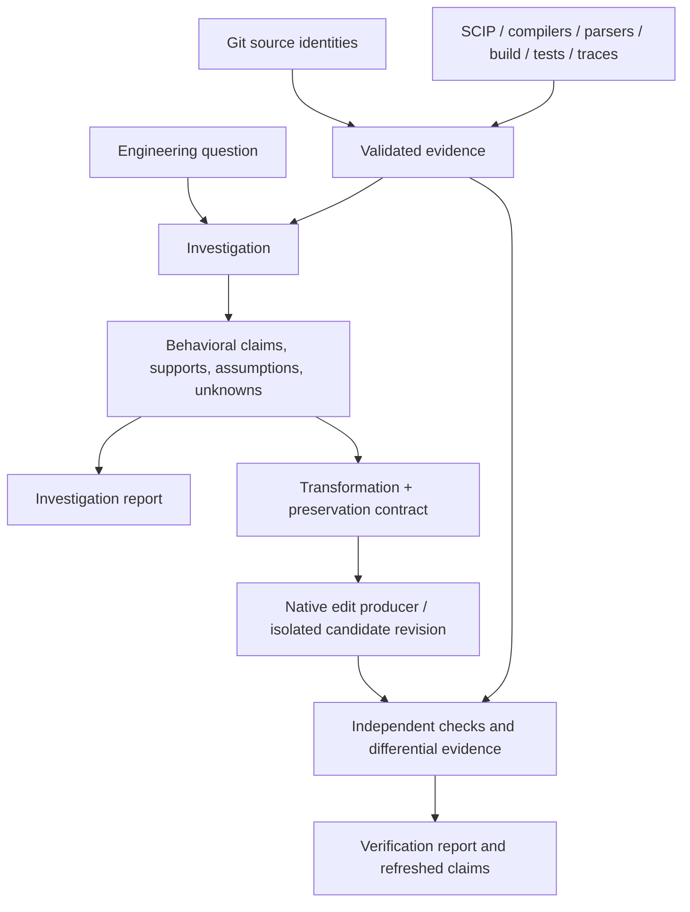

# Architecture: investigation-driven understanding and transformation

This document is the **canonical architecture**. The
[product contract](PRODUCT.md) and [ADR 0001](DECISIONS/0001-investigation-first.md)
define direction; this page distinguishes architecture already present
from interfaces and persistence still to be built.

## Architectural invariant

A software question selects the needed evidence; source inspection and
bounded reasoning produce explicit behavioral claims; a transformation
consumes those claims and emits preservation obligations; independent
verification checks those obligations. Git source, provider observations,
derived models and engineering decisions have separate authority.

**Currently built:** much of the Git/evidence layer, bounded discovery,
context, impact, audit and native-edit building blocks.

**Target, not yet shipped as a single workflow:** persistent question-scoped
investigation and claim objects, transformation obligations joined to those
claims, dependency-aware invalidation and a unified verification report.

## Data engineering responsibilities

The [evidence lifecycle](EVIDENCE_LIFECYCLE.md) adapts five responsibilities:
generation, ingestion, storage, transformation and serving.

- Generation: provider-specific source observations and independently run checks.
- Ingestion: authenticate source objects, source bindings, receipt digests and
  coverage; preserve original semantics.
- Storage: rebuildable Rust/SQLite indexes and typed evidence, with Git
  authority retained and raw receipts referencable.
- Transformation: on-demand explanation, competing hypotheses, architectural
  models and change-preservation obligations.
- Serving: bounded CLI/MCP/GitHub results today, investigation and
  transformation artifacts when implemented.

Do not confuse **data transformation** (evidence to explanation) with
**code transformation** (an isolated source edit). Both require lineage,
but only the latter changes executable source.

## Existing ownership and paths

| Responsibility | Existing implementation | Boundary |
| --- | --- | --- |
| Source authority | [Git source](../core/src/source/git.rs), [identity](../core/src/source/identity.rs) | Source is Git, not SQLite |
| Scope and discovery | [Discovery](../core/src/discovery.rs) | Explicit source roots/configuration |
| Native observations | [SCIP evidence](../core/src/scip_evidence.rs), [observed relations](../core/src/observed_relations.rs) | Producer semantics remain distinct |
| Evidence and indexing | [Index](../core/src/index.rs), [evidence store](../core/src/evidence_store.rs) | Original receipts and gaps preserved |
| Agent discovery | [Agent locate](../core/src/agent_locate.rs), [agent analysis](../core/src/agent.rs) | Bounded candidates and reading plan, not full behavioral proof |
| Impact and changes | [Impact](../core/src/impact.rs), [explain](../core/src/explain.rs) | Candidate change effects, not certified equivalence |
| Native edits | [Refactoring](../core/src/refactor.rs), [improvement edits](../core/src/improve_edits.rs) | Explicit plan, bounded replay; independent checks |
| Runtime | [Rust CLI](../core/src/bin/excession.rs), [MCP](../core/src/bin/excession/mcp.rs) | Same core evidence, different transport |

Existing Git-bound FTS5 caches, native source analyzers, SQLite relationships
and typed evidence contracts are valuable **providers and accelerators**.
They should not be replaced by new indexing infrastructure simply to
implement the investigation interface.

## Interfaces today

- **CLI:** `discover`, `analyze`, `agent locate`, `agent context`,
  `impact`, `explain`, `agent verify` and specialist refactoring,
  native-evidence and test workflows. See [CLI](CLI.md).
- **MCP:** repository-scoped read-only tools
  `search_code`, `get_context`, `explain_impact`, `verify_change`,
  `plan_tests` and `check_coverage`. See [MCP](MCP.md).
- **GitHub:** on-demand exact-commit source analysis and a separate
  reusable PR evidence workflow. See [GitHub analysis](GITHUB_NATIVE_ANALYSIS.md)
  and [PR evidence](GITHUB_EVIDENCE.md).

GitHub-hosted analysis does not require Cloud Run, a separate server or
a custom ChatGPT MCP installation. Stdio MCP remains local.

## Claim and authority model (target)

An investigation report must identify source revision, relevant source,
provider receipts, behavioral claims, assumptions, counterevidence and
unknowns. A transformation must attach preservation obligations and exact
candidate edits. Verification must name precisely what checks establish.

A code location and Git hash authenticate **where**, not **what happens**.
A SCIP reference is not a runtime call. A passing build or test is not
general equivalence. Absent producer data is not proof of no dependency.
See [investigations](INVESTIGATIONS.md),
[transformations](TRANSFORMATIONS.md),
[verification](VERIFICATION.md) and [evidence limits](EVIDENCE_AND_LIMITS.md).

## Invalidation, persistence and trust

Derived conclusions must not survive a changed source/configuration dependency
without re-examination. Caches remain disposable; raw producer provenance and
original Git identities remain inspectable. Cross-revision reuse needs
exact unchanged inputs **and** the relevant environmental assumptions.

Read-only workflows must not execute untrusted project code or edit the user
checkout. Native edit application must be separately authorized in isolated
worktrees. Evidence does not authorize merge or skipping tests.

## Evolution constraints

No second SCIP implementation, universal parser, alternative Git authority,
always-on warehouse, or wholesale graph materialization as a prerequisite to
answering a question. Prefer small modules for evidence, investigations,
transformation plans and verification, reusing the existing Rust core.

The previous [target-architecture branch notes](TARGET_ARCHITECTURE.md)
are historical module-ownership work, not a competing direction. Success is
measured by [independent code-understanding and refactoring studies](EVALUATION.md),
not edge count.
